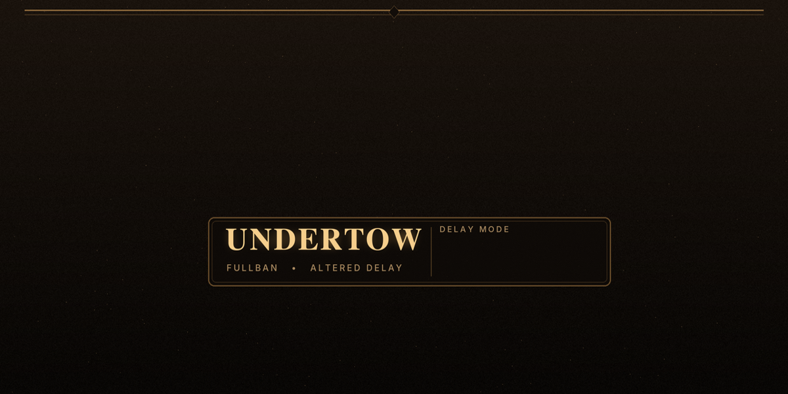

# Undertow

An altered stereo delay for Akai MPC / Force standalone, by Fullban. Built with the MPC Plugin SDK.



Four modes (Analogue, Tape, Lo-Fi, Reverse) with **Time, Sync** (tempo divisions), **Repeats** (up to runaway feedback), **Tone, Degrade, Spread, Mix** and a **Tails** switch that lets echoes ring out or cuts them with the input. Nine factory presets.

Inspired by the general idea of "altered delay" pedals (a DigiTech Obscura-style feature set). It is an original implementation and is **not affiliated with or endorsed by DigiTech/HARMAN or anyone else**.

## Install

* **Open MPC catalog** (root-modded devices): install from the catalog page, or unzip the release zip and run `install.sh`.
* **Official route** (MPC OS 3.10.1+, Preferences → Enhancements (Beta) → Enable Enhancements and VST2 Support): copy the `Fullban - VST - Undertow` folder from the release into a `VST2 Plugins` folder on a drive.

## Build

```
release/build.sh
```

## Status (honest notes)

* Passes the SDK host-simulator tests and catalog checks. Not benchmarked for CPU on a device yet.
* Parameter positions are fixed from 1.0.0 (new parameters are appended only).

## Licence

MIT, see `LICENSE`; SDK files see `LICENSE-SDK` and `THIRD_PARTY.md`.
